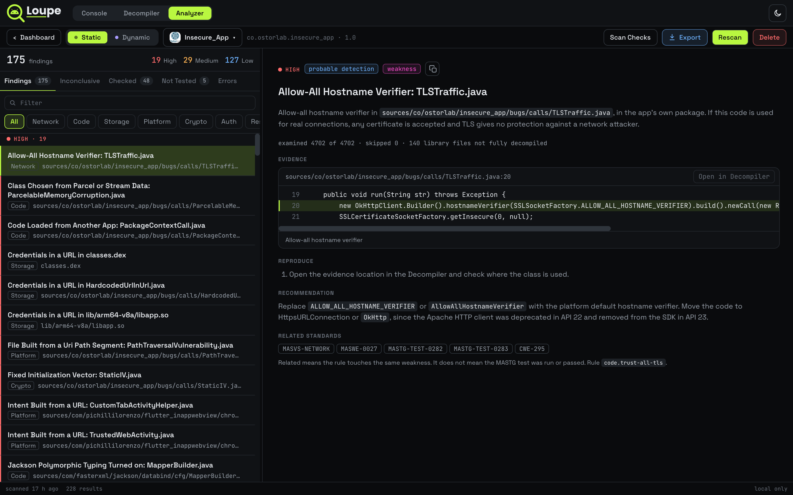

Control, inspect and debug an Android phone from your browser, decompile its apps, and analyze them for security weaknesses in the same tab. Over USB it needs no drivers, no desktop `adb` server and no agent app on the device. Over Wi-Fi it uses the `adb` tools already on your computer.

Loupe speaks the ADB protocol straight from the page, so a live screen mirror, a shell, a file manager, logcat, proxy interception, memory dumps and Frida all run in one tab. It has three views:

- Console for the live device.
- Decompiler for turning an APK into readable Java, a decoded manifest and resources, and a searchable source tree.
- Analyzer for finding security weaknesses in an app. Static analysis scans the decompiled app, and dynamic analysis records the app running on the phone. Every finding comes with evidence, steps to reproduce and a recommendation.


## Features

### Console


- Screen mirror and control. Live H.264 mirror over [scrcpy](https://github.com/Genymobile/scrcpy), with touch, keys, screenshots and screen recording.
- Logcat, Network, Processes, Performance. Live logs with filters and a per-app view, the socket table, a process list, and a device dashboard (CPU, memory, FPS, battery, network, storage).
- Memory and Inspector. `dumpsys meminfo`, process maps and heap dumps (an ELF core when `am dumpheap` cannot help), plus the view hierarchy.
- Files, Apps, Settings, Device Info. Browse and edit files with previews (including SQLite), manage packages (install, uninstall, launch, force stop, clear data), edit the `system`, `secure` and `global` settings, and read `getprop`.
- Shell. An `adb shell` with history, and a reboot menu.
- Frida. Install and start the `frida-server` release that matches Loupe's own client, pick an app, run a script against it (or paste a CodeShare, GitHub or Gist link) and watch the output.
- Proxy. Point the phone at your intercepting proxy (Burp, HTTP Toolkit) with one button and install its CA into the system trust store.
- Two-pane workspace. Drag tabs between two panes, resize them, and keep one panel open while you work in another.
- Root-aware. On a rooted device Loupe reaches protected paths, other processes and non-debuggable heap dumps.

When Android blocks an install, Loupe asks before overriding it. For Play Protect, **Install Anyway** turns off Play Protect scanning for installs over adb until you turn it back on.

### Decompiler


- Open an APK from disk (drop several at once) or pull an installed app from the phone.
- Read the app. Decompiled Java, the decoded manifest and resources, search across code, resources and names, and deobfuscation options.
- Decompiled Apps. A table of every app you have opened, with version, SDK range, size, when it was decompiled and when it was last analyzed. Reopen, **Analyze**, view results or delete from the row.
- APK info and signature. Manifest facts and a v1 through v3.1 signature check.
- One-click setup. The first time, Loupe asks before downloading a private Java runtime and jadx (about 140 MB, checksum-pinned) into `~/.loupe/tools`. jadx runs in an OS sandbox on macOS and Linux. Windows has no usable sandbox, so the decompiler is off there (see [Windows](#windows)).

### Analyzer



Pick a decompiled app, then choose a mode.

- Static reads the decoded manifest, network config, signature, native libraries and decompiled code. It runs entirely on your computer.
- Dynamic records the app on the connected phone (log, network connections, files) while you use it, and can run opt-in probes against its exported components and content providers.

The Analyzer opens on one dashboard for both modes. Each app with a stored result has a Static row and a Dynamic row, with the High, Medium and Low counts, status and last run. Drop an APK on the dashboard (or anywhere in the window while on the Analyzer) and Loupe decompiles it and starts a static scan. Each row has its own **View Results**, **Rescan** (or **New Session**) and delete buttons, and a mode that has not been run shows a button to run it. The dynamic buttons need a connected phone.

Every finding has a severity, a description, the evidence with an **Open in Decompiler** jump, steps to reproduce, a recommendation, and related OWASP and CWE references. Results are honest about gaps: rules that were inconclusive, not tested or failed are listed with the reason, and no finding is reported without evidence. **Export** saves a Markdown report with finding IDs such as `INSH-01`.

Dynamic probes that change app state are off by default, and the session is blocked unless the installed build matches the decompiled APK. See [`DEVELOPMENT.md`](DEVELOPMENT.md) for how the rules and probes work.

## Getting started

You need a Chromium browser (Chrome or Edge, since WebUSB is Chromium only), Node 20 or newer, and a phone with USB debugging turned on.

```bash
git clone https://github.com/capt-meelo/loupe
cd loupe
npm install
npm run dev
```

Open <http://localhost:5173>. The dev server also starts the Loupe bridge on port `8090`, which the ADB, Frida, Proxy, Decompiler and Analyzer features use. `npm run build` makes a production bundle in `dist/`.

On Linux the decompiler needs `bubblewrap` (`sudo apt install bubblewrap`). macOS has a sandbox built in.

### What each feature needs

| Feature | Needs on your computer | Needs on the phone |
|---|---|---|
| USB connection | Nothing extra | USB debugging |
| Wi-Fi connection | `adb` | Wireless debugging |
| Decompiler | Network access once, to download Java and jadx. On Linux, `bubblewrap` | Nothing |
| Analyzer | A decompiled app | Nothing |
| Frida server install | `xz`, and network access to GitHub | Root, to start the server |
| Proxy CA install | `openssl` | Root |
| Protected files, other processes' memory | Nothing | Root |

### Connecting a device

**Over USB.** Turn on USB debugging, plug the phone in, and stop any desktop adb server first (`adb kill-server`), since it holds the USB interface. Then pick **Connect over USB** in the device menu and tap **Allow USB debugging** on the phone.

**Over Wi-Fi.** Pick **Connect over Wi-Fi**. Pair with a code or QR the first time, or type an `address:port` if the phone is already paired.

### Windows

Everything except the decompiler should run natively on Windows, but native Windows is untested. Frida install needs `xz` and the proxy CA step needs `openssl` on your `PATH`. For the decompiler, run Loupe inside [WSL2](https://learn.microsoft.com/windows/wsl/install) with Ubuntu and keep using Chrome on Windows:

```bash
sudo apt install bubblewrap xz-utils openssl android-tools-adb
npm install && npm run dev
```

USB mirroring still works because WebUSB runs in Windows Chrome. For Wi-Fi, Ubuntu's `adb` has no mDNS, so use the **Pair Code** and **Connect** tabs with the `ip:port` from the phone's Wireless debugging screen.

## Built with

- [ya-webadb](https://github.com/yume-chan/ya-webadb) for ADB over WebUSB
- [scrcpy](https://github.com/Genymobile/scrcpy) for mirroring
- [Frida](https://frida.re) for instrumentation
- [jadx](https://github.com/skylot/jadx) and an [Eclipse Temurin](https://adoptium.net) JRE for the decompiler
- [CodeMirror](https://codemirror.net) and [sql.js](https://github.com/sql-js/sql.js)
- [React](https://react.dev) and [Vite](https://vitejs.dev)

## Notes for contributors

Architecture, the security model, connection internals and troubleshooting are in [`DEVELOPMENT.md`](DEVELOPMENT.md).
